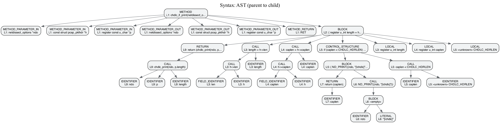
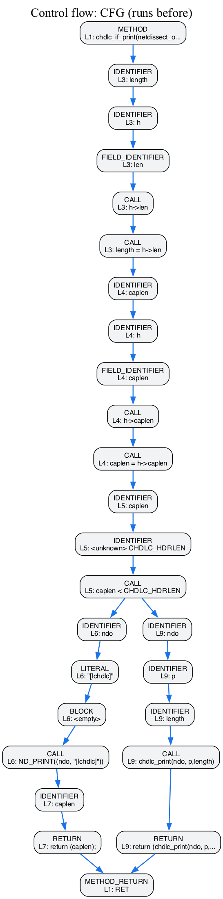
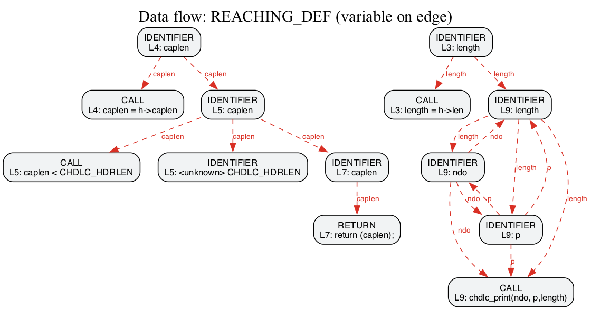

# VulnGNN: Graph-Based Vulnerability Detection, Tested on Code It Has Never Seen

> **Status (24 November 2026):** Full Joern extraction and audit are complete locally (117,673 planned; 107,461 graphs; zero audit errors). The node-type-only R-GCN has three cross-project seeds (mean AP 0.111), three within-project seeds on one fixed split (mean AP 0.156, sample SD 0.023), and four single-seed relation ablations. A same-function matched evaluation compares the seed-42 graph model with legacy text baselines across 20,957 held-out functions; AP differences are small and project-bootstrap intervals include zero, so no graph advantage is established. A validation-selected 50–60% precision threshold failed to transfer to held-out projects (test precision 0.000–0.179). The local UI reports these results and supports local source-to-graph inference when the ignored runtime artifacts are present. CodeBERT and Transformers now import successfully, and a 12-graph CUDA feature-generation smoke run passed; full raw/masked feature extraction and CodeBERT model training remain to do. A preliminary patch-overlap localization proxy measures top-1/3/5 hits at 0.189/0.344/0.435 versus exact random expectations 0.108/0.234/0.321; this is not ground-truth line localization. See docs/short_report.md and docs/APP_CONTROL_RUNTIME.md.

See the current measured [project report](docs/short_report.md), the [local artifact manifest](LOCAL_ARTIFACTS.md), and the [Mac Codex handoff prompt](RAGINI_REMOTE_CODEX_PROMPT.md).

## Research question and hypothesis
**Research question:** Does code-property-graph structure improve vulnerability detection on projects the model has never seen, especially after identifiers are abstracted?

**Hypothesis:** AST, control-flow and data-flow structure may retain signals, but the current graph results do not establish that graph models outperform text baselines.

## Problem
Detect vulnerable C/C++ functions with a gated graph neural network over code property graphs (AST + control-flow + data-flow), localize the vulnerable lines, and evaluate on **projects the model has never seen**, against static-analysis and ML baselines.

## Dataset
BigVul (Fan et al., MSR 2020), authors' dataset mirrored at [`starsofchance/MSR_data_cleaned`](https://huggingface.co/datasets/starsofchance/MSR_data_cleaned). The expected source archive is 1,541,009,577 bytes with SHA-256 `be96d4133fe4e75a2c5dd3f36eae22939612083cd1f7bcaa3bb5ce782316e0f2`; the downloader uses `token=False`.

| | Functions | Vulnerable | Projects |
|---|---|---|---|
| Raw | 188,636 | 10,900 (5.8%) | 310 |
| After cleaning | 182,100 | 8,609 (4.7%) | 295 (aliases merged) |

Cleaning removed 334 vulnerable rows whose fix only changes comments or whitespace; 2,602 rows in normalized-function groups with conflicting labels (including 1,274 vulnerable rows); 1,884 redundant normalized duplicates; and 1,716 functions longer than 8,000 characters (including 616 vulnerable rows).

**Language:** BigVul's language tag says 98.6% C, but sampled rows include C++ code (class methods in Chrome, Android, KDE and others) tagged as C, so the dataset should be treated as C/C++. File extensions are selected heuristically from language tags and syntax; C++ markers inside comments can cause false `.cpp` classification.


## Evaluation protocol
- **Within-project split:** grouped by (project, function name), so the same function never appears on both sides.
- **Cross-project split:** whole projects held out for validation and test. Chrome, linux, Android and hosting-site pseudo-projects are train-only; the rest assigned by a seeded shuffle (seed 42), not hand-picked.
- **Leakage audit (MinHash, Jaccard >= 0.8 on token 5-grams):** cross-project validation/test have 21/59 near-duplicate rows (0.2% each; 1/2 vulnerable); within-project validation/test have 513/474 (2.8%/2.6%; 17/16 vulnerable). Flagged cross-project rows are excluded from evaluation.
- **Metrics:** average precision, precision at fixed recall, F1. Accuracy is not reported (only 4.7% of functions are vulnerable).
- Hyperparameters and decision thresholds are chosen on the validation split only.

Saved split sizes from `results/split_report.txt`:

| Split setting | Role | Functions | Vulnerable | Projects | Prevalence |
|---|---|---:|---:|---:|---:|
| Within-project | Train | 145,679 | 6,887 | 294 | 4.73% |
| Within-project | Validation | 18,210 | 861 | 261 | 4.73% |
| Within-project | Test | 18,211 | 861 | 259 | 4.73% |
| Cross-project | Train | 148,784 | 7,017 | 120 | 4.72% |
| Cross-project | Validation | 9,390 | 531 | 66 | 5.65% |
| Cross-project | Test | 23,926 | 1,061 | 109 | 4.43% |

These saved split counts are before near-duplicate filtering. Evaluation drops 21 cross-project validation rows and 59 test rows flagged `near_dup_cross` (including 1 and 2 vulnerable rows), which is why the baseline tables use 9,369/530 and 23,867/1,059.

The cross-project train-only project set is `Chrome`, `linux`, `Android`, `savannah`, `launchpad`, `infradead`, `lysator`, `pengutronix`, `src`, `kde`, and `drm`. Project alias merges and the cross-project allocation are documented in `docs/decisions.md`.


## Baseline results (Phase 2A; seed 42)

The complete result table, including cluster-bootstrap AP intervals, is [`results/baselines_v2.csv`](results/baselines_v2.csv). TF-IDF C and F1 thresholds were selected on validation only; test rows were evaluated once with those settings. Intervals resample whole projects for cross-project and whole function groups for within-project. Row-level bootstrap intervals are retained and labeled optimistic in `results/bootstrap_ci_comparison.csv`. The raw-token model selected C=10.0 within-project and C=0.03 cross-project (`results/baseline_tuning_v2.csv`).

| Split | Model | Variant | AP (cluster 95% CI) | P @ 30% recall | F1 |
|---|---|---|---:|---:|---:|
| Within | Length | chars/lines | 0.114 (0.102-0.131) | 0.132 | 0.179 |
| Within | TF-IDF + LogReg | Raw tokens | 0.356 (0.317-0.400) | 0.497 | 0.394 |
| Within | TF-IDF + LogReg | API-preserving mask | 0.147 (0.127-0.168) | 0.173 | 0.220 |
| Within | TF-IDF + LogReg | Fully masked | 0.143 (0.125-0.164) | 0.168 | 0.221 |
| Cross | Length | chars/lines | 0.117 (0.089-0.143) | 0.144 | 0.201 |
| Cross | TF-IDF + LogReg | Raw tokens | 0.105 (0.084-0.129) | 0.132 | 0.186 |
| Cross | TF-IDF + LogReg | API-preserving mask | 0.122 (0.094-0.157) | 0.160 | 0.204 |
| Cross | TF-IDF + LogReg | Fully masked | 0.124 (0.097-0.158) | 0.161 | 0.209 |

The older single-mask result in `results/baseline_results.csv` changed raw-token AP from 0.356 to 0.141 within-project and from 0.105 to 0.121 cross-project. Its cross-project row-bootstrap intervals overlap (raw 0.097–0.117; masked 0.111–0.136), and the masked point estimate is close to length-only AP 0.117. Those row-level intervals are optimistic. The expanded v2 API-preserving and fully masked variants are shown separately above and use cluster-bootstrap intervals. These are one-seed comparisons: the masking results are consistent with vocabulary sensitivity, but do not prove project-vocabulary memorization is the cause. Per-project scores are in `results/per_project_baselines_v2.csv` (projects require at least 30 vulnerable test functions).


The short claim/evidence boundary is recorded in [`results/baselines_v2_conclusion.md`](results/baselines_v2_conclusion.md). The cross-project test prevalence is 0.0444; eligible test results exclude `near_dup_cross` rows.

## Semgrep baseline (Community Edition)

Semgrep 1.185.0 ran the frozen `p/c` snapshot on both test sets. The upstream snapshot has two C rules; the runner adds derived copies of those same patterns for Semgrep's `cpp` parser. The effective four-rule configuration hash is `a936fb1c81084c67f6b0a988fd61f26824e3b3ffd7df6ec369b246300a985660` (upstream SHA-256 `71e7aa2e2611f937ad5e4be7ba12bdb93c188c1de6db30be5b24aeb5b3c395ff`; derived C++ overlay SHA-256 `2b21aba70d1d913db9a47cbf11d0065e2bef58cc437a46d2368494495a5e5406`). No functions generated alerts.

| Split | Test functions | Prevalence | C files scanned | C++ files written | Targets scanned | Parse errors | Precision | Recall | F1 |
|---|---:|---:|---:|---:|---:|---:|---:|---:|---:|
| Within-project | 18,211 | 0.0473 | 11,227 | 6,984 | 18,211 (100%) | 68 | 0.000 | 0.000 | 0.000 |
| Cross-project | 23,867 | 0.0444 | 22,431 | 1,436 | 23,867 (100%) | 167 | 0.000 | 0.000 | 0.000 |

The C++ rules are pattern copies of the upstream C rules with their language and rule IDs changed to `cpp`; they are not Semgrep's proprietary Pro rules. All eligible targets were scanned; Semgrep reported 68 within-project and 167 cross-project parse warnings, with zero timeouts and crashes. Its open-source C/C++ engine and four-rule configuration provide narrow coverage, and produced no alerts. With zero recall, a matched-recall comparison with a nonzero-recall model is not possible.

## Cppcheck baseline

Cppcheck 2.22.0 scanned the same fixed test sets with a two-second per-function timeout. The operating point was fixed in advance: flag any warning- or error-severity finding. A Cppcheck `syntaxError` is itself an error-severity finding, so it is counted as flagged and also reported as a parse failure. Timed-out or crashed rows would be retained as unflagged; none occurred. The same C/C++ extension heuristic used for the frozen Semgrep run was applied. Full per-function output and settings are under `results/cppcheck/full/`.

| Split | Test functions | Positives | Flagged | Parse failures | Timeouts | Crashes | Precision | Recall | F1 |
|---|---:|---:|---:|---:|---:|---:|---:|---:|---:|
| Within-project | 18,211 | 861 | 1,113 | 359 | 0 | 0 | 0.0800 | 0.1034 | 0.0902 |
| Cross-project | 23,867 | 1,059 | 2,053 | 213 | 0 | 0 | 0.0828 | 0.1605 | 0.1093 |

Cppcheck found some vulnerable functions at this fixed operating point, unlike the frozen Semgrep rules, but precision remains low. The C++ function-snippet parse failures can contribute error findings and therefore false alerts; this is a static-analysis operating-point comparison, not evidence that all reported functions contain exploitable vulnerabilities.

## Graph extraction pilot (Joern)

A first test of the graph stage: 60 BigVul functions (30 vulnerable, 30 safe; 253–1,126 characters, one per project per class) were parsed with Joern into code property graphs (`results/pilot/manifest.csv`).

- **57 of 60 functions (95%)** produced a function graph. The three failures are recorded as `no_method`; their individual causes have not been determined.
- BigVul's language tag is unreliable (9 of the 60 sampled rows were C++), so the dataset is C/C++. The final pilot manifest records the chosen `.c`/`.cpp` extensions.
- **Graph size:** about 83 nodes and 635 edges per function on average (about 82 syntax edges, 68 control-flow edges, 162 data-flow edges, 45 control-dependence edges, plus other edge types).
- **Each graph maps back to its function:** every function is written as `f_<hash>.c` or `.cpp`; the graph JSON stores that ID with the label, project, commit and CVE.
- **Note:** in BigVul a safe function carries the CVE of the commit it came from, so label 0 with a CVE ID is expected.
- **Runner:** `bash scripts/run_pilot.sh` runs the pilot extraction and report.

Example: `chdlc_if_print` from tcpdump (CVE-2017-13687, label: vulnerable), 38 nodes.
- Syntax: the function body block contains `length = h->len` and `caplen = h->caplen`.
- Control flow: execution branches at the `if` on line 5 into an early-return path and the main path, which meet again at the method exit.
- Data flow: `caplen`, assigned on line 4, flows to the bounds check on line 5 and to `return (caplen)` on line 7.

**Syntax (AST)**



**Control flow (CFG)**



**Data flow (REACHING_DEF)**



**Pilot limitations:** the sample is small and length-matched, so graph sizes say nothing about class differences. Functions come without headers, so macros and types stay unresolved (for example `<unknown> CHDLC_HDRLEN`).

## Roadmap
- [x] **Phase 1:** data, cleaning, leakage-safe splits, leakage audit
- [ ] **Phase 2:** graph pipeline and baselines
  - [x] Initial text baselines (length only, TF-IDF + logistic regression)
  - [x] Expanded C grid and identifier-masking ablation (one seed run)
  - [x] Joern graph extraction pilot (57 of 60 functions)
  - [x] Deterministic graph workset planner (seeded safe-row sampling)
  - [x] Full Joern batch extraction and parse-coverage audit (117,673 planned; 107,461 graphs; zero audit errors; local Windows run)
  - [x] Semgrep baseline (frozen 4-rule C/C++ configuration; no alerts)
  - [x] Graph extraction at full scale (local Windows run; checkpoint archive saved under results/)
  - [x] PyTorch Geometric type-only feature shards for all 107,461 successful graphs (21 node types)
  - [ ] CodeBERT raw-token and identifier-masked features (imports and a 12-graph smoke shard work; full feature extraction remains; see `docs/APP_CONTROL_RUNTIME.md`)
- [ ] **Phase 3:** R-GCN results now include three cross-project seeds, three within-project seeds, four cross-project single-seed edge ablations, a matched-cohort text-baseline comparison, precision-target transfer analysis, and preliminary changed-line localization. The 50–60% precision targets chosen on validation did not transfer to held-out projects. Remaining work: full raw/masked CodeBERT feature extraction and GNN training, independently tuned ablations, and verified vulnerability-line labels.

## Reproduce
```bash
python -m venv .venv && source .venv/bin/activate
pip install -r requirements.txt
python scripts/download_bigvul.py
cd data/raw && unzip -q MSR_data_cleaned.zip && cd ../..
python src/vulngnn/data/prepare_bigvul.py
python src/vulngnn/data/make_splits.py
python src/vulngnn/data/near_dup_check.py
PYTHONPATH=src python src/vulngnn/train/baseline_tfidf.py
PYTHONPATH=src python src/vulngnn/eval/make_figures.py
```

### Preliminary type-only R-GCN on the local Windows GPU

The 59 type-only feature shards are already saved in `data/graph_dataset/joern_type_only/`. The measured seed-42 cross-project run used the following validation-selected parameters; its test results are in `results/gnn/joern_type_only/cross/all_edges/`.

```powershell
$env:PYTHONPATH = (Resolve-Path .\src).Path
.\.venv-gpu\Scripts\python.exe -m vulngnn.train.train_gnn `
  --setting cross `
  --data .\data\graph_dataset\joern_type_only `
  --output .\results\gnn `
  --device cuda --batch-size 128 --epochs 25 --patience 5 `
  --hidden-dim 256 --layers 4 --dropout 0.1624074561769746 `
  --lr 0.00016998978382700775 --weight-decay 0.000001493656855461763 `
  --pos-weight-scale 1.7992642186624028
```

To run the local website and C/C++ inference API, use the same `.venv-gpu` environment and open `http://127.0.0.1:8000`:

```powershell
.\.venv-gpu\Scripts\python.exe .\scripts\serve_web.py --host 127.0.0.1 --port 8000
```

Analysis uploads are sent only to this localhost server. The current model score is uncalibrated and is a research output, not a security verdict. The API uses the bundled Joern CLI and selects features from the active checkpoint: the checked-in runtime currently has the node-type-only model; CodeBERT inference activates only when matching feature metadata and a trained CodeBERT checkpoint are present. The upload review also runs the built-in risky-pattern checks and, when available, Cppcheck 2.22; each result is a diagnostic to verify, not a confirmed vulnerability. On Windows, install Cppcheck from [the official download page](https://cppcheck.sourceforge.io/) and set `$env:VULNGNN_CPPCHECK` to the full path of `cppcheck.exe` if it is not on `PATH`. The local demo copy under `tools/cppcheck/` is intentionally ignored by Git, so a fresh clone needs its own Cppcheck installation.

Reproduce the complete Phase 2A baseline suite (frozen local Semgrep rules, resumable scans, validation-tuned text grid, cluster intervals, tables and figures):
```bash
./scripts/run_baselines.sh
```

Baseline dependencies and complete reproduction (Semgrep rules are local; Cppcheck must be installed separately):
```bash
source .venv/bin/activate
python -m pip install -r requirements-semgrep.txt
brew install cppcheck
./scripts/run_baselines.sh
```
The reproducible Phase 2A runner uses checked-in local Semgrep rules, resumable Semgrep and per-function Cppcheck results, the validation-tuned text grid, and writes tables and figures under `results/`. It excludes `near_dup_cross` rows from cross-project evaluation. Treat both static analyzers as narrow operating-point baselines, not complete C/C++ security audits.

Graph workset planning (safe to run on the laptop; does not write source files):
```bash
source .venv/bin/activate
PYTHONPATH=src python -m vulngnn.graphs.prepare_graph_workset --plan-only
```
The planner selects vulnerable functions, eligible validation/test rows (excluding cross-project near-duplicates), and a seeded sample of safe training functions. The complete local workset has 117,673 functions in 59 batches of 2,000; its manifest and project coverage table are under `data/graph_workset/`. Full Joern extraction and audit have completed locally; the measured 2,000-function seed-42 throughput sample is documented below.

The processed data and Joern installation are excluded from Git. Package those inputs together with the reviewed graph-pipeline and checkpoint tools for a private Kaggle Dataset upload with:
```bash
.venv/bin/python scripts/package_kaggle_inputs.py \
  --joern-dir /private/tmp/joern-cli-linux-x86_64-v4.0.665/joern-cli \
  --workset-dir results/graph_throughput_2k/full_workset_batch2000 \
  --output /private/tmp/vulngnn-phase2b-kaggle-v4.tar.gz
ls -lh /private/tmp/vulngnn-phase2b-kaggle-v4.tar.gz
shasum -a 256 /private/tmp/vulngnn-phase2b-kaggle-v4.tar.gz
```
The earlier `/private/tmp/vulngnn-phase2b-inputs-batch2000.tar.gz` archive bundled macOS Joern binaries and must not be used on Kaggle. The Linux x86_64 Joern 4.0.665 package used in the smoke run was 1,913,587,851 bytes (SHA-256 `16427a07f97b021fdb48897b527029648b9a1c50ee5d3c1714c1526e3a942564`); it contains the processed parquet, extraction source, requirements, and 117,673-row manifest. The latest verified Kaggle CPU smoke (notebook version 4, 2026-11-16) ran only batch `00000` (2,000 functions) on Linux x86_64 with 4 CPUs, Python 3.13.18, pandas 2.3.3, PyArrow 23.0.1, OpenJDK 21.0.12, and Joern 4.0.665. It produced 1,830 graphs (1,797 `ok`, 33 `ok_truncated`), 170 `no_method`, and zero `batch_error`; safe coverage was 1,686/1,842 (91.3%) and vulnerable coverage was 144/158 (91.1%). Measured stage times were parse 25.829 s, export 7.216 s, conversion 12.481 s, and batch 46.629 s. Process-tree peak RSS sampled every 250 ms was 1,217.13 MiB. A seeded 20-graph integrity sample passed; resume validated and skipped the completed batch, preserving graph JSONL SHA-256 `53524c780bbb89df3db8eeb316155b61a3692bce5f2d26f344d27cc7cd7f974d`. The checkpoint archive SHA-256 is `eb0dfe380f7340b46da8f17cf8f4f75c23b4f20b242ab7518a1c97cfc3d04039`. The archive and `.sha256` sidecar were downloaded to `~/Downloads`, verified and restored into a clean temporary workset; Kaggle session was then stopped and the local archive was reverified. This verifies one-batch compatibility and checkpoint recovery only; it is not full-workset extraction evidence. The [checked-in Kaggle notebook](notebooks/phase2b_kaggle_graph_extraction.ipynb) defaults to one batch and documents the checkpoint restore path and chunk procedure.

A refreshed upload bundle was built from the current worktree at `/private/tmp/vulngnn-phase2b-kaggle-v4.tar.gz`: 1,913,591,909 bytes, SHA-256 `c13c5587d2bd6249aa3481cdb4de868d50588bdc2ba8749dbecdc8ed22ff314f`. It includes `restore_graph_checkpoint.py`, the updated pipeline and the full workset manifest/metadata. This exact package was uploaded as a private Kaggle Dataset, checked against its SHA-256 inside Kaggle, and used in the notebook version 4 one-batch smoke. Rebuild it with the command above and repeat the hash check after any packaged input changes.

### Kaggle persistence and chunk recovery

Kaggle showed **No persistence** for the smoke session. Treat `/kaggle/working` as ephemeral: stopping, expiring, or resetting a session can delete the workset, compact graphs, metadata, and logs. A clean one-batch run took about 50 seconds. The local 2,000-function measurement suggests about 42.4 minutes for 59 batches, 5.13 GB cumulative temporary CSV output, and 1.71 GB compact JSONL output; these are linear estimates, not guarantees. Plan for at least 8 GB free working storage for the extracted input copy, active batch scratch, compact output, logs, and a compressed checkpoint, and verify the actual disk meter before each chunk.

Before launching any full extraction, rebuild and upload the private input Dataset from the current worktree so it includes the integrity marker and `restore_graph_checkpoint.py` support. Use CPU, attach the private input Dataset, and leave the notebook `BATCH_LIMIT = 1` for a smoke rerun. For the full run only after reviewing this smoke and package version, set cumulative limits to 10, 20, 30, 40, 50, and 59. Prefix 10 revalidates and skips tested batch `00000`, then runs `00001`–`00009`; each next prefix processes only its new suffix after validating prior batches. Each run produces a versioned `graphs-through-*.tar.gz` plus `.sha256` file under `/kaggle/working`. Verify the sidecar, then download both files or save them as a private Kaggle output Dataset version **before stopping the session**. “Save Version” must finish and expose the artifacts, or keep a verified local download. On a fresh session attach exactly one latest checkpoint Dataset and the original inputs Dataset; the notebook verifies the archive hash, its per-file hashes, and exact manifest/metadata identity before restoring. Restore refuses conflicting or extra completed-batch files already in the workset; use a fresh workset or remove only the conflicting batch files before retrying. Missing source snippets for unfinished batches are reconstructed from the original parquet. If verification fails, do not resume from that archive: use the previous verified checkpoint and retain the corrupt one for diagnosis. A batch is skipped only when its completion marker, graph JSONL, stats CSV, manifest fields, and recorded SHA-256 hashes validate. A changed, missing, or mismatched artifact is rerun and replaced only after conversion succeeds.

The working tree for a Kaggle session is `/kaggle/working/graph_workset/`: the immutable selection files are at its root; Joern input snippets and failed attempt scratch are under `batches/batch_NNNNN/`; compact graph JSONL, per-function stats, completion markers, aggregate coverage, audits, metrics, and quality checks are under `graphs/`; and runner/resume logs are under `logs/`. The restart archive includes these graph outputs and logs, but deliberately omits source snippets and failed raw Joern scratch. The notebook can re-read only its small seeded quality sample from the source parquet after restoring a checkpoint. The archive and checksum sidecar are written at `/kaggle/working/graphs-through-<prefix>-<timestamp>.tar.gz[.sha256]`.

The private Kaggle notebook was saved as version 4 with Quick Save after the successful one-batch run; the saved version showed the `.tar.gz.bin` package hash guard and `BATCH_LIMIT = 1`. The package archive SHA-256 was checked inside Kaggle before extraction. The one-batch checkpoint recovery procedure was also verified locally after the Kaggle session stopped. Before any full run, rebuild the private Linux x86_64 input Dataset from the current worktree using the command above, compare its SHA-256 with the printed value, attach it with CPU, and use the reviewed notebook. For full extraction, retain the packaged dependency pins. Do not start the next prefix until the previous prefix has a zero-error audit, a verified archive and sidecar, and a durable Kaggle output Dataset version or local download. If a run stops mid-prefix, reattach the last verified checkpoint and rerun that same cumulative prefix; integrity markers cause only fully validated batches to be skipped.

### 2,000-function Joern throughput sample

On the local Java 21 environment, one 2,000-function Joern batch (1,863 safe, 137 vulnerable; 1,098 C and 902 C++; 167 projects) produced 1,823 graphs (91.15%); 177 had no matching method and 34 successful graphs were truncated at 500 nodes. Parse/export/conversion took 23.572/4.570/13.779 seconds; runner wall time was 42.436 seconds and measured wall time including startup was 43.227 seconds. Peak runner-process-tree RSS sampled every 250 ms was 1,399.17 MiB. The CSV export was 87,213,654 bytes before cleanup; compact graphs were 29,112,576 bytes. A repeat with the same batch size produced identical successful graph objects; comparison to two 1,000-function batches showed small node/edge differences in four graphs, so keep batch size fixed. The 20 source/graph quality-check sample was unchanged in the 2,000-batch output, and the pipeline resume smoke skipped the completed batch and passed audit. Full-workset linear estimates are about 42.4 minutes, 5.13 GB cumulative temporary CSV, and 1.71 GB compact graphs; full-run time and peak RAM are not measured. See [`results/graph_throughput_2k/`](results/graph_throughput_2k/) and [`docs/decisions.md`](docs/decisions.md) for coverage by class/extension, failure analysis, assumptions, and Kaggle constraints.
Compact graphs are written as JSONL under `data/graph_workset/graphs/`; per-function and aggregated project/split/class parse coverage is written alongside them. Graphs larger than 500 nodes retain the first 500 nodes in deterministic AST breadth-first order and record the original count and dropped-node count. Only AST, CFG, REACHING_DEF and CDG edges are kept.

The independent audit checks that every planned uid has exactly one status, every successful status has exactly one JSONL graph, metadata and labels match the manifest, edge indices stay within the node list, and truncation counts agree. Use `--allow-partial` only to audit a limited smoke run; a full run should report `complete: true` and an empty `errors` list in `graphs/audit_summary.json`.

Full-workset Joern extraction produced 107,461 graphs from 117,673 planned functions (91.32% coverage); the independent audit reported zero batch errors and zero audit errors. Results and the checkpoint archive are under `data/graph_workset/graphs/` and `results/graphs_full_2026-11-16.tar.gz`. METHOD nodes are matched by uid in Joern's filename; when several candidates match, the largest AST subtree is selected, which may choose the wrong method in unusual nested/wrapper cases. The 2,000-function sample above is a throughput estimate, not a guarantee for individual batches.

The planned PyG node-type vocabulary is built only from rows whose roles are `train` in both split definitions, without reading labels or test performance. Unseen node types map to `__UNK__`. Graphs are truncated to the first 500 AST nodes in breadth-first order; this can discard later code and its edges, so the full run must report truncation coverage by class and split.

### PyTorch Geometric graph features

After Joern extraction, build the raw-identifier CodeBERT feature shards on Kaggle's GPU:
```bash
pip install -r requirements-gnn.txt
python -m pip show torch torch-geometric transformers
PYTHONPATH=src python -m vulngnn.graphs.build_pyg_dataset --device cuda --batch-size 64
PYTHONPATH=src python -m vulngnn.graphs.build_pyg_dataset --device cuda --batch-size 64 --mask-identifiers
```
The converter writes sharded `torch_geometric.data.Data` objects under `data/graph_dataset/codebert_raw/` and `codebert_masked/`. `x` concatenates one-hot node types with frozen CodeBERT CLS embeddings stored in float16; `edge_index`, integer `edge_type`, node `line_numbers`, `y`, split flags and `norm_hash` are retained. Each shard can be resumed. `GraphShardDataset` lazily reads the outputs. For a smaller smoke run, pass `--input` to a directory containing one or a few `batch_*.jsonl` files and `--out` to a temporary destination.

### R-GCN training

Tune on validation, then reuse that configuration for three final seeds. Run this for each split; the cross split excludes `near_dup_cross` rows from validation and test. Repeat with `data/graph_dataset/codebert_masked` for the identifier ablation.
```bash
PYTHONPATH=src python -m vulngnn.train.train_gnn --setting within --device cuda --tune-trials 20 --seed 42
PYTHONPATH=src python -m vulngnn.train.train_gnn --setting within --device cuda --config-json results/gnn/codebert_raw/within/all_edges/best_hparams.json --seed 43
PYTHONPATH=src python -m vulngnn.train.train_gnn --setting within --device cuda --config-json results/gnn/codebert_raw/within/all_edges/best_hparams.json --seed 44
PYTHONPATH=src python -m vulngnn.train.train_gnn --setting cross --device cuda --tune-trials 20 --seed 42
PYTHONPATH=src python -m vulngnn.train.train_gnn --setting cross --device cuda --config-json results/gnn/codebert_raw/cross/all_edges/best_hparams.json --seed 43
PYTHONPATH=src python -m vulngnn.train.train_gnn --setting cross --device cuda --config-json results/gnn/codebert_raw/cross/all_edges/best_hparams.json --seed 44
```
The driver selects the best checkpoint by validation AP, chooses the F1 threshold on validation only, and reports test AP, prevalence, threshold metrics and a project-cluster AP interval. It saves per-project metrics only for projects with at least 30 vulnerable test functions and updates `seed_summary.csv` as additional seeds finish. For the identifier-masked ablation, add `--data data/graph_dataset/codebert_masked` to each command. To run a single-edge ablation, add `--edge-ablation REACHING_DEF` (or `AST`, `CFG`, `CDG`); each variant gets its own output/config folder. Repeat the same tuning and three-seed commands for each feature variant and split.

### Line localization

The localizer ranks source lines by the sum of absolute input gradients over nodes mapped to each line. Changed lines come from `func_before`/`func_after` diffs; fix-only inserted lines map to the adjacent vulnerable-source line. It reports top-1/3/5 hit rates and a random-lines baseline on vulnerable test graphs with changed lines and line-mapped nodes.
```bash
PYTHONPATH=src python -m vulngnn.explain.localize_gnn \
  --data data/graph_dataset/codebert_raw \
  --predictions results/gnn/codebert_raw/cross/all_edges/test_scores_seed42.parquet \
  --checkpoint results/gnn/codebert_raw/cross/all_edges/model_seed42.pt \
  --output results/gnn/codebert_raw/cross/all_edges/localization_seed42 \
  --device cuda
```
The output contains per-function line rankings and hit indicators plus coverage and aggregate hit rates. Run it separately for each split, seed and feature variant; no localization results exist until the full graphs and trained checkpoints are available.

### Baseline comparison

For the paired legacy v1 text baseline versus the seed-42 type-only GNN comparison on identical graph-covered test functions, regenerate the 1,000-replicate whole-project bootstrap table:
```bash
python scripts/evaluate_matched_baseline_comparison.py
```
It verifies normalized function IDs, labels, and project assignments before calculating metrics. The comparison is explicitly labeled legacy v1; the complete text-baseline table uses the later v2 validation-tuned scores.

Baseline score files include `norm_hash` so comparisons can be restricted to the exact rows that also produced graphs. The legacy score file was aligned to function IDs only after checking every saved label and row count; `PYTHONPATH=src python -m vulngnn.eval.align_baseline_scores` repeats this strict alignment if needed. Compare a trained model with all baselines on the shared graph-covered rows:
```bash
PYTHONPATH=src python -m vulngnn.eval.compare_graph_baselines \
  --gnn-scores results/gnn/codebert_raw/cross/all_edges/test_scores_seed42.parquet \
  --output results/gnn/comparison_cross_seed42.csv
```
The report gives AP and precision at 30%/50% recall for ranked ML models, plus Semgrep's precision/recall/F1 at its fixed alert operating point. Since the current Semgrep run has zero alerts (recall 0), a matched-recall comparison to a nonzero-recall GNN is unavailable; the report marks this explicitly.

Graph pilot (macOS; needs Java 21, Graphviz, coreutils and Joern):
```bash
brew install openjdk@21 graphviz coreutils
mkdir -p tools && cd tools
curl -L "https://github.com/joernio/joern/releases/latest/download/joern-install.sh" -o joern-install.sh
chmod u+x joern-install.sh
./joern-install.sh --install-dir="$PWD/joern" --without-plugins
cd ..
bash scripts/run_pilot.sh
```

## Limitations
- C and C++ (the dataset's language tag is unreliable); labels come from vulnerability-fix commits and are known to be noisy.
- Cleaning removes 21% of vulnerable examples (mostly label-conflict rows), so the dataset is easier than raw BigVul.
- Function-name grouping is coarse for macro-wrapped definitions (e.g. `PHP_FUNCTION`); this over-groups, which is safe for leakage.
- Near-duplicate check uses a 0.8 threshold; heavily modified copies may remain.
- Text baselines are single-seed results; repeat seeds before treating the cross-project masking gain as stable. AP confidence intervals use project/function-group cluster bootstrap; row-level bootstrap comparisons are retained as optimistic.
- Semgrep reported 68 within-project and 167 cross-project parse-error snippets; these were retained and scored unflagged when no finding was emitted. No timeouts or crashes occurred. Cppcheck 2.22.0 had 359 within-project and 213 cross-project `syntaxError` files, no timeouts/crashes, and low precision at the fixed any-warning/error operating point; parse errors that emit an error finding count as flagged. These snippet-based results may include parser-induced false alerts.
- Semgrep CE's frozen `p/c` snapshot has two C rules, with locally derived C++ copies; the four-rule set produced no alerts, so its metrics are a limited operating-point baseline.
- Graph extraction coverage is 95% on the pilot sample; full-scale coverage is not yet measured.
