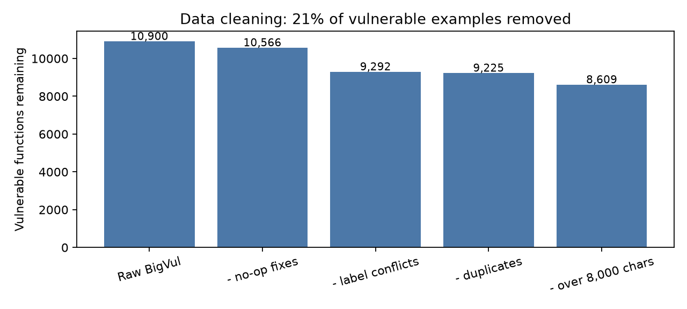
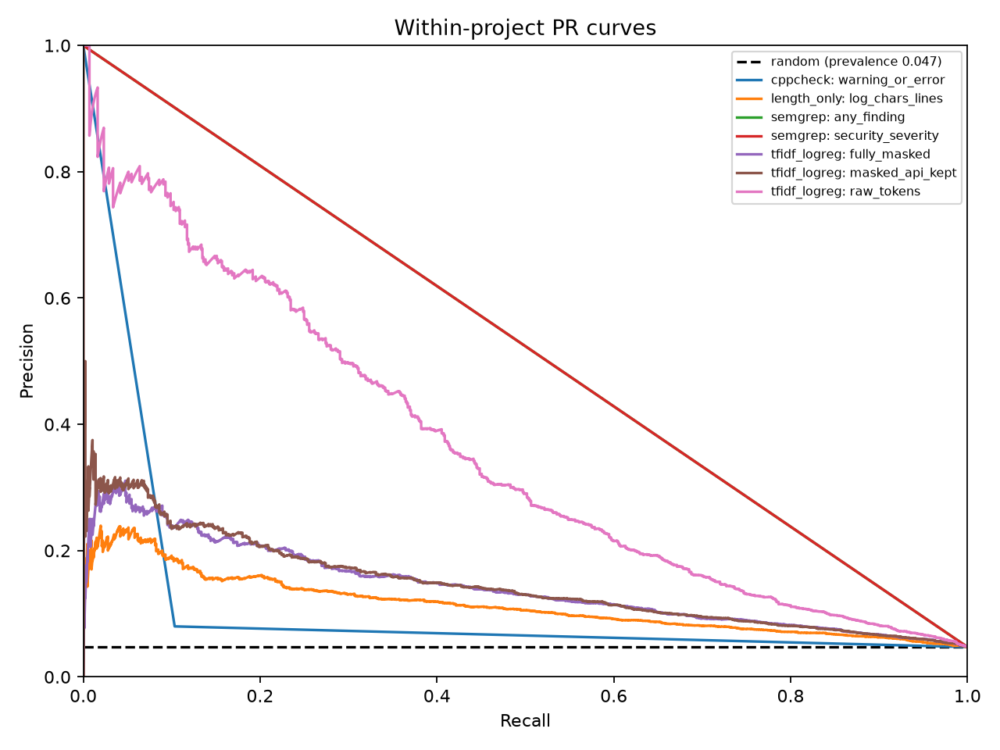
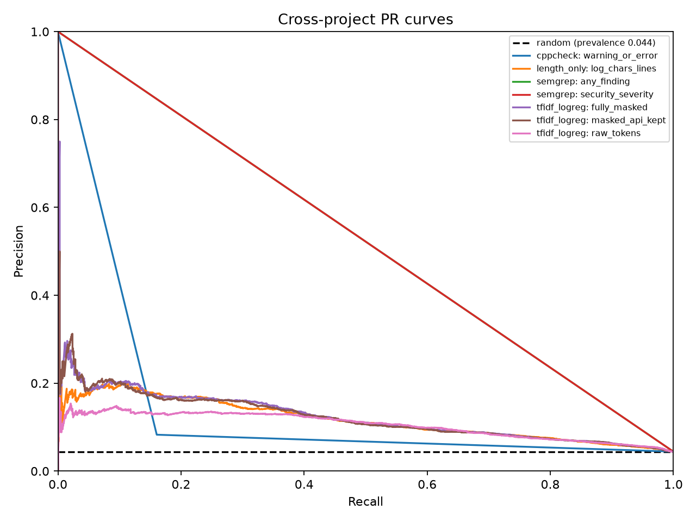
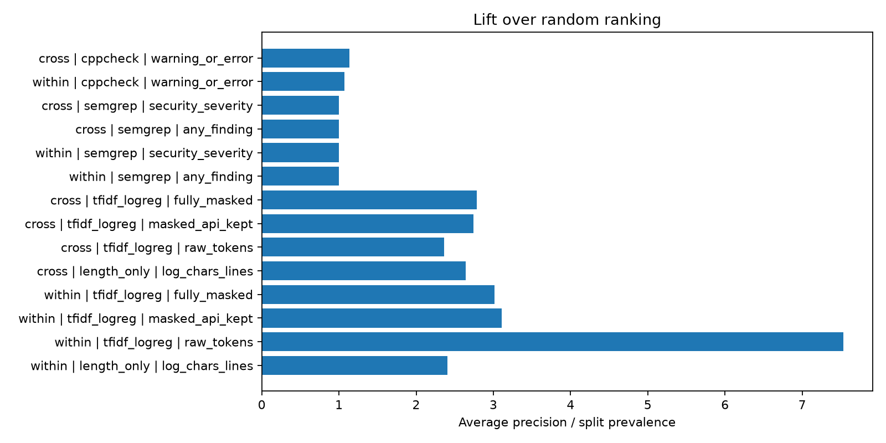

# GNN-Based Source Code Vulnerability Detection

> **Status:** Phase 1 (data and evaluation foundation) complete. Phase 2 in progress: expanded text, Semgrep Community Edition, and Cppcheck baselines are measured; full-scale graph extraction and the graph dataset remain. No GNN results yet.

See the concise measured [project progress report](docs/short_report.md); it labels unmeasured GNN and localization work as pending.

## Problem
Detect vulnerable C/C++ functions with a gated graph neural network over code property graphs (AST + control-flow + data-flow), localize the vulnerable lines, and evaluate on **projects the model has never seen**, against static-analysis and ML baselines.

## Dataset
BigVul (Fan et al., MSR 2020), authors' dataset mirrored at [`starsofchance/MSR_data_cleaned`](https://huggingface.co/datasets/starsofchance/MSR_data_cleaned). The expected source archive is 1,541,009,577 bytes with SHA-256 `be96d4133fe4e75a2c5dd3f36eae22939612083cd1f7bcaa3bb5ce782316e0f2`; the downloader uses `token=False`.

| | Functions | Vulnerable | Projects |
|---|---|---|---|
| Raw | 188,636 | 10,900 (5.8%) | 310 |
| After cleaning | 182,100 | 8,609 (4.7%) | 295 (aliases merged) |

Cleaning removed 334 vulnerable rows whose fix only changes comments or whitespace; 2,602 rows in normalized-function groups with conflicting labels (including 1,274 vulnerable rows); 1,884 redundant normalized duplicates; and 1,716 functions longer than 8,000 characters (including 616 vulnerable rows).

**Language:** BigVul's language tag says 98.6% C, but sampled rows include C++ code (class methods in Chrome, Android, KDE and others) tagged as C, so the dataset should be treated as C/C++.



## Evaluation protocol
- **Within-project split:** grouped by (project, function name), so the same function never appears on both sides.
- **Cross-project split:** whole projects held out for validation and test. Chrome, linux, Android and hosting-site pseudo-projects are train-only; the rest assigned by a seeded shuffle (seed 42), not hand-picked.
- **Leakage audit (MinHash, Jaccard >= 0.8 on token 5-grams):** cross-project validation/test have 21/59 near-duplicate rows (0.2% each; 1/2 vulnerable); within-project validation/test have 513/474 (2.8%/2.6%; 17/16 vulnerable). Flagged cross-project rows are excluded from evaluation.
- **Metrics:** average precision, precision at fixed recall, F1. Accuracy is not reported (only 4.7% of functions are vulnerable).
- Hyperparameters and decision thresholds are chosen on the validation split only.

Saved split sizes from `results/split_report.txt`:

| Split setting | Role | Functions | Vulnerable | Projects | Prevalence |
|---|---|---:|---:|---:|---:|
| Within-project | Train | 145,679 | 6,887 | 294 | 4.73% |
| Within-project | Validation | 18,210 | 861 | 261 | 4.73% |
| Within-project | Test | 18,211 | 861 | 259 | 4.73% |
| Cross-project | Train | 148,784 | 7,017 | 120 | 4.72% |
| Cross-project | Validation | 9,390 | 531 | 66 | 5.65% |
| Cross-project | Test | 23,926 | 1,061 | 109 | 4.43% |

These saved split counts are before near-duplicate filtering. Evaluation drops 21 cross-project validation rows and 59 test rows flagged `near_dup_cross` (including 1 and 2 vulnerable rows), which is why the baseline tables use 9,369/530 and 23,867/1,059.

The cross-project train-only project set is `Chrome`, `linux`, `Android`, `savannah`, `launchpad`, `infradead`, `lysator`, `pengutronix`, `src`, `kde`, and `drm`. Project alias merges and the cross-project allocation are documented in `docs/decisions.md`.


## Baseline results (Phase 2A; seed 42)

The complete result table, including cluster-bootstrap AP intervals, is [`results/baselines_v2.csv`](results/baselines_v2.csv). TF-IDF C and F1 thresholds were selected on validation only; test rows were evaluated once with those settings. Intervals resample whole projects for cross-project and whole function groups for within-project. Row-level bootstrap intervals are retained and labeled optimistic in `results/bootstrap_ci_comparison.csv`. The raw-token model selected C=10.0 within-project and C=0.03 cross-project (`results/baseline_tuning_v2.csv`).

| Split | Model | Variant | AP (cluster 95% CI) | P @ 30% recall | F1 |
|---|---|---|---:|---:|---:|
| Within | Length | chars/lines | 0.114 (0.102-0.131) | 0.132 | 0.179 |
| Within | TF-IDF + LogReg | Raw tokens | 0.356 (0.317-0.400) | 0.497 | 0.394 |
| Within | TF-IDF + LogReg | API-preserving mask | 0.147 (0.127-0.168) | 0.173 | 0.220 |
| Within | TF-IDF + LogReg | Fully masked | 0.143 (0.125-0.164) | 0.168 | 0.221 |
| Cross | Length | chars/lines | 0.117 (0.089-0.143) | 0.144 | 0.201 |
| Cross | TF-IDF + LogReg | Raw tokens | 0.105 (0.084-0.129) | 0.132 | 0.186 |
| Cross | TF-IDF + LogReg | API-preserving mask | 0.122 (0.094-0.157) | 0.160 | 0.204 |
| Cross | TF-IDF + LogReg | Fully masked | 0.124 (0.097-0.158) | 0.161 | 0.209 |

The older single-mask result in `results/baseline_results.csv` changed raw-token AP from 0.356 to 0.141 within-project and from 0.105 to 0.121 cross-project. Its cross-project row-bootstrap intervals overlap (raw 0.097–0.117; masked 0.111–0.136), and the masked point estimate is close to length-only AP 0.117. Those row-level intervals are optimistic. The expanded v2 API-preserving and fully masked variants are shown separately above and use cluster-bootstrap intervals. These are one-seed comparisons: the masking results are consistent with vocabulary sensitivity, but do not prove project-vocabulary memorization is the cause. Per-project scores are in `results/per_project_baselines_v2.csv` (projects require at least 30 vulnerable test functions).





The short claim/evidence boundary is recorded in [`results/baselines_v2_conclusion.md`](results/baselines_v2_conclusion.md). The cross-project test prevalence is 0.0444; eligible test results exclude `near_dup_cross` rows.

## Semgrep baseline (Community Edition)

Semgrep 1.185.0 ran the frozen `p/c` snapshot on both test sets. The upstream snapshot has two C rules; the runner adds derived copies of those same patterns for Semgrep's `cpp` parser. The effective four-rule configuration hash is `a936fb1c81084c67f6b0a988fd61f26824e3b3ffd7df6ec369b246300a985660` (upstream SHA-256 `71e7aa2e2611f937ad5e4be7ba12bdb93c188c1de6db30be5b24aeb5b3c395ff`; derived C++ overlay SHA-256 `2b21aba70d1d913db9a47cbf11d0065e2bef58cc437a46d2368494495a5e5406`). No functions generated alerts.

| Split | Test functions | Prevalence | C files scanned | C++ files written | Targets scanned | Parse errors | Precision | Recall | F1 |
|---|---:|---:|---:|---:|---:|---:|---:|---:|---:|
| Within-project | 18,211 | 0.0473 | 11,227 | 6,984 | 18,211 (100%) | 68 | 0.000 | 0.000 | 0.000 |
| Cross-project | 23,867 | 0.0444 | 22,431 | 1,436 | 23,867 (100%) | 167 | 0.000 | 0.000 | 0.000 |

The C++ rules are pattern copies of the upstream C rules with their language and rule IDs changed to `cpp`; they are not Semgrep's proprietary Pro rules. All eligible targets were scanned; Semgrep reported 68 within-project and 167 cross-project parse warnings, with zero timeouts and crashes. Its open-source C/C++ engine and four-rule configuration provide narrow coverage, and produced no alerts. With zero recall, a matched-recall comparison with a nonzero-recall model is not possible.

## Cppcheck baseline

Cppcheck 2.22.0 scanned the same fixed test sets with a two-second per-function timeout. The operating point was fixed in advance: flag any warning- or error-severity finding. A Cppcheck `syntaxError` is itself an error-severity finding, so it is counted as flagged and also reported as a parse failure. Timed-out or crashed rows would be retained as unflagged; none occurred. The same C/C++ extension heuristic used for the frozen Semgrep run was applied. Full per-function output and settings are under `results/cppcheck/full/`.

| Split | Test functions | Positives | Flagged | Parse failures | Timeouts | Crashes | Precision | Recall | F1 |
|---|---:|---:|---:|---:|---:|---:|---:|---:|---:|
| Within-project | 18,211 | 861 | 1,113 | 359 | 0 | 0 | 0.0800 | 0.1034 | 0.0902 |
| Cross-project | 23,867 | 1,059 | 2,053 | 213 | 0 | 0 | 0.0828 | 0.1605 | 0.1093 |

Cppcheck found some vulnerable functions at this fixed operating point, unlike the frozen Semgrep rules, but precision remains low. The C++ function-snippet parse failures can contribute error findings and therefore false alerts; this is a static-analysis operating-point comparison, not evidence that all reported functions contain exploitable vulnerabilities.

## Graph extraction pilot (Joern)

A first test of the graph stage: 60 BigVul functions (30 vulnerable, 30 safe; 253–1,126 characters, one per project per class) were parsed with Joern into code property graphs (`results/pilot/manifest.csv`).

- **57 of 60 functions (95%)** produced a function graph. The three failures are recorded as `no_method`; their individual causes have not been determined.
- BigVul's language tag is unreliable (9 of the 60 sampled rows were C++), so the dataset is C/C++. The final pilot manifest records the chosen `.c`/`.cpp` extensions.
- **Graph size:** about 83 nodes and 635 edges per function on average (about 82 syntax edges, 68 control-flow edges, 162 data-flow edges, 45 control-dependence edges, plus other edge types).
- **Each graph maps back to its function:** every function is written as `f_<hash>.c` or `.cpp`; the graph JSON stores that ID with the label, project, commit and CVE.
- **Note:** in BigVul a safe function carries the CVE of the commit it came from, so label 0 with a CVE ID is expected.
- **Runner:** `bash scripts/run_pilot.sh` runs the pilot extraction and report.

Example: `chdlc_if_print` from tcpdump (CVE-2017-13687, label: vulnerable), 38 nodes.
- Syntax: the function body block contains `length = h->len` and `caplen = h->caplen`.
- Control flow: execution branches at the `if` on line 5 into an early-return path and the main path, which meet again at the method exit.
- Data flow: `caplen`, assigned on line 4, flows to the bounds check on line 5 and to `return (caplen)` on line 7.

**Syntax (AST)**


**Control flow (CFG)**


**Data flow (REACHING_DEF)**


**Pilot limitations:** the sample is small and length-matched, so graph sizes say nothing about class differences. Functions come without headers, so macros and types stay unresolved (for example `<unknown> CHDLC_HDRLEN`).

## Roadmap
- [x] **Phase 1:** data, cleaning, leakage-safe splits, leakage audit
- [ ] **Phase 2:** graph pipeline and baselines
  - [x] Initial text baselines (length only, TF-IDF + logistic regression)
  - [x] Expanded C grid and identifier-masking ablation (one seed run)
  - [x] Joern graph extraction pilot (57 of 60 functions)
  - [x] Deterministic graph workset planner (seeded safe-row sampling)
  - [ ] Joern batch extraction and parse-coverage audit on Kaggle (runner added; full run pending)
  - [x] Semgrep baseline (frozen 4-rule C/C++ configuration; no alerts)
  - [ ] Graph extraction at full scale (Kaggle)
  - [ ] PyTorch Geometric dataset with CodeBERT node features (converter added; full data conversion pending)
- [ ] **Phase 3:** R-GCN model implemented; training, ablations (edge types, layers, with/without identifier text), Optuna tuning on project-disjoint validation, localization against fix diffs, final evaluation

## Reproduce
```bash
python -m venv .venv && source .venv/bin/activate
pip install -r requirements.txt
python scripts/download_bigvul.py
cd data/raw && unzip -q MSR_data_cleaned.zip && cd ../..
python src/vulngnn/data/prepare_bigvul.py
python src/vulngnn/data/make_splits.py
python src/vulngnn/data/near_dup_check.py
PYTHONPATH=src python src/vulngnn/train/baseline_tfidf.py
PYTHONPATH=src python src/vulngnn/eval/make_figures.py
```

Reproduce the complete Phase 2A baseline suite (frozen local Semgrep rules, resumable scans, validation-tuned text grid, cluster intervals, tables and figures):
```bash
./scripts/run_baselines.sh
```

Baseline dependencies and complete reproduction (Semgrep rules are local; Cppcheck must be installed separately):
```bash
source .venv/bin/activate
python -m pip install -r requirements-semgrep.txt
brew install cppcheck
./scripts/run_baselines.sh
```
The reproducible Phase 2A runner uses checked-in local Semgrep rules, resumable Semgrep and per-function Cppcheck results, the validation-tuned text grid, and writes tables and figures under `results/`. It excludes `near_dup_cross` rows from cross-project evaluation. Treat both static analyzers as narrow operating-point baselines, not complete C/C++ security audits.

Graph workset planning (safe to run on the laptop; does not write source files):
```bash
source .venv/bin/activate
PYTHONPATH=src python -m vulngnn.graphs.prepare_graph_workset --plan-only
```
The planner code selects vulnerable functions, eligible validation/test rows (excluding cross-project near-duplicates), and a seeded sample of safe training functions. Full workset counts have not been recorded as a results artifact, and full Joern extraction has not run. Review a fresh read-only plan before materializing it. Full source-file generation and Joern extraction should run on Kaggle. To materialize the workset there, run `PYTHONPATH=src python -m vulngnn.graphs.prepare_graph_workset --negative-ratio 5 --batch-size 1000`.

The processed data and Joern installation are excluded from Git. Package them locally for a private Kaggle Dataset upload with:
```bash
.venv/bin/python scripts/package_kaggle_inputs.py
ls -lh /private/tmp/gnn-vulnerability-kaggle-inputs.tar.gz
```
The archive preserves `data/processed/bigvul_clean.parquet` and `tools/joern/joern-cli`. After adding that private dataset to a Kaggle notebook, extract it under `/kaggle/working`:
```bash
tar -xzf /kaggle/input/<your-dataset>/gnn-vulnerability-kaggle-inputs.tar.gz -C /kaggle/working
```

Make a checkout containing the reviewed graph-pipeline source available in `/kaggle/working` as well; this local workspace may include uncommitted changes. Set Java 21 in the Kaggle runtime. The wrapper prepares the workset if needed, runs Joern with resume enabled, audits the results, and can bundle the compact outputs for download. Start with one batch:
```bash
python scripts/run_graph_pipeline.py \
  --data /kaggle/input/<prepared-data>/bigvul_clean.parquet \
  --joern-dir /kaggle/input/<joern-input>/joern-cli \
  --java-home "$JAVA_HOME" \
  --workset /kaggle/working/data/graph_workset \
  --limit-batches 1 \
  --archive /kaggle/working/graph-smoke.tar.gz
```
If the smoke audit is clean, rerun the same command without `--limit-batches` and change the archive name to `graphs-full.tar.gz`. The wrapper resumes already-complete batches by default. Keep `/kaggle/working` as the workset location so Kaggle can expose the output archive when the notebook is saved. If the Kaggle runtime does not set `JAVA_HOME`, locate its Java 21 installation and pass that directory explicitly.
Compact graphs are written as JSONL under `data/graph_workset/graphs/`; per-function and aggregated project/split/class parse coverage is written alongside them. Graphs larger than 500 nodes retain the first 500 nodes in deterministic AST breadth-first order and record the original count and dropped-node count. Only AST, CFG, REACHING_DEF and CDG edges are kept.

The independent audit checks that every planned uid has exactly one status, every successful status has exactly one JSONL graph, metadata and labels match the manifest, edge indices stay within the node list, and truncation counts agree. Use `--allow-partial` only to audit a limited smoke run; a full run should report `complete: true` and an empty `errors` list in `graphs/audit_summary.json`.

The full workset runner and graph audit are prepared but have not produced full-scale extraction results. The pilot above is the available measured graph extraction evidence.

### PyTorch Geometric graph features

After Joern extraction, build the raw-identifier CodeBERT feature shards on Kaggle's GPU:
```bash
pip install -r requirements-gnn.txt
python -m pip show torch torch-geometric transformers
PYTHONPATH=src python -m vulngnn.graphs.build_pyg_dataset --device cuda --batch-size 64
PYTHONPATH=src python -m vulngnn.graphs.build_pyg_dataset --device cuda --batch-size 64 --mask-identifiers
```
The converter writes sharded `torch_geometric.data.Data` objects under `data/graph_dataset/codebert_raw/` and `codebert_masked/`. `x` concatenates one-hot node types with frozen CodeBERT CLS embeddings stored in float16; `edge_index`, integer `edge_type`, node `line_numbers`, `y`, split flags and `norm_hash` are retained. Each shard can be resumed. `GraphShardDataset` lazily reads the outputs. For a smaller smoke run, pass `--input` to a directory containing one or a few `batch_*.jsonl` files and `--out` to a temporary destination.

### R-GCN training

Tune on validation, then reuse that configuration for three final seeds. Run this for each split; the cross split excludes `near_dup_cross` rows from validation and test. Repeat with `data/graph_dataset/codebert_masked` for the identifier ablation.
```bash
PYTHONPATH=src python -m vulngnn.train.train_gnn --setting within --device cuda --tune-trials 20 --seed 42
PYTHONPATH=src python -m vulngnn.train.train_gnn --setting within --device cuda --config-json results/gnn/codebert_raw/within/all_edges/best_hparams.json --seed 43
PYTHONPATH=src python -m vulngnn.train.train_gnn --setting within --device cuda --config-json results/gnn/codebert_raw/within/all_edges/best_hparams.json --seed 44
PYTHONPATH=src python -m vulngnn.train.train_gnn --setting cross --device cuda --tune-trials 20 --seed 42
PYTHONPATH=src python -m vulngnn.train.train_gnn --setting cross --device cuda --config-json results/gnn/codebert_raw/cross/all_edges/best_hparams.json --seed 43
PYTHONPATH=src python -m vulngnn.train.train_gnn --setting cross --device cuda --config-json results/gnn/codebert_raw/cross/all_edges/best_hparams.json --seed 44
```
The driver selects the best checkpoint by validation AP, chooses the F1 threshold on validation only, and reports test AP, prevalence, threshold metrics and a project-cluster AP interval. It saves per-project metrics only for projects with at least 30 vulnerable test functions and updates `seed_summary.csv` as additional seeds finish. For the identifier-masked ablation, add `--data data/graph_dataset/codebert_masked` to each command. To run a single-edge ablation, add `--edge-ablation REACHING_DEF` (or `AST`, `CFG`, `CDG`); each variant gets its own output/config folder. Repeat the same tuning and three-seed commands for each feature variant and split.

### Line localization

The localizer ranks source lines by the sum of absolute input gradients over nodes mapped to each line. Changed lines come from `func_before`/`func_after` diffs; fix-only inserted lines map to the adjacent vulnerable-source line. It reports top-1/3/5 hit rates and a random-lines baseline on vulnerable test graphs with changed lines and line-mapped nodes.
```bash
PYTHONPATH=src python -m vulngnn.explain.localize_gnn \
  --data data/graph_dataset/codebert_raw \
  --predictions results/gnn/codebert_raw/cross/all_edges/test_scores_seed42.parquet \
  --checkpoint results/gnn/codebert_raw/cross/all_edges/model_seed42.pt \
  --output results/gnn/codebert_raw/cross/all_edges/localization_seed42 \
  --device cuda
```
The output contains per-function line rankings and hit indicators plus coverage and aggregate hit rates. Run it separately for each split, seed and feature variant; no localization results exist until the full graphs and trained checkpoints are available.

### Baseline comparison

Baseline score files include `norm_hash` so comparisons can be restricted to the exact rows that also produced graphs. The legacy score file was aligned to function IDs only after checking every saved label and row count; `PYTHONPATH=src python -m vulngnn.eval.align_baseline_scores` repeats this strict alignment if needed. Compare a trained model with all baselines on the shared graph-covered rows:
```bash
PYTHONPATH=src python -m vulngnn.eval.compare_graph_baselines \
  --gnn-scores results/gnn/codebert_raw/cross/all_edges/test_scores_seed42.parquet \
  --output results/gnn/comparison_cross_seed42.csv
```
The report gives AP and precision at 30%/50% recall for ranked ML models, plus Semgrep's precision/recall/F1 at its fixed alert operating point. Since the current Semgrep run has zero alerts (recall 0), a matched-recall comparison to a nonzero-recall GNN is unavailable; the report marks this explicitly.

Graph pilot (macOS; needs Java 21, Graphviz, coreutils and Joern):
```bash
brew install openjdk@21 graphviz coreutils
mkdir -p tools && cd tools
curl -L "https://github.com/joernio/joern/releases/latest/download/joern-install.sh" -o joern-install.sh
chmod u+x joern-install.sh
./joern-install.sh --install-dir="$PWD/joern" --without-plugins
cd ..
bash scripts/run_pilot.sh
```

## Limitations
- C and C++ (the dataset's language tag is unreliable); labels come from vulnerability-fix commits and are known to be noisy.
- Cleaning removes 21% of vulnerable examples (mostly label-conflict rows), so the dataset is easier than raw BigVul.
- Function-name grouping is coarse for macro-wrapped definitions (e.g. `PHP_FUNCTION`); this over-groups, which is safe for leakage.
- Near-duplicate check uses a 0.8 threshold; heavily modified copies may remain.
- Text baselines are single-seed results; repeat seeds before treating the cross-project masking gain as stable. AP confidence intervals use project/function-group cluster bootstrap; row-level bootstrap comparisons are retained as optimistic.
- Semgrep reported 68 within-project and 167 cross-project parse-error snippets; these were retained and scored unflagged when no finding was emitted. No timeouts or crashes occurred. Cppcheck 2.22.0 had 359 within-project and 213 cross-project `syntaxError` files, no timeouts/crashes, and low precision at the fixed any-warning/error operating point; parse errors that emit an error finding count as flagged. These snippet-based results may include parser-induced false alerts.
- Semgrep CE's frozen `p/c` snapshot has two C rules, with locally derived C++ copies; the four-rule set produced no alerts, so its metrics are a limited operating-point baseline.
- Graph extraction coverage is 95% on the pilot sample; full-scale coverage is not yet measured.
