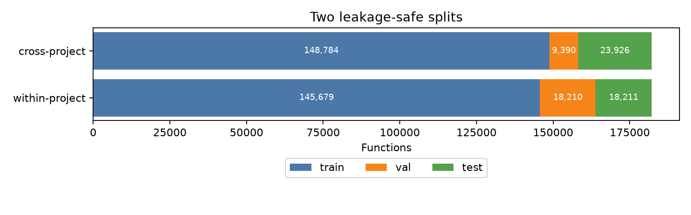
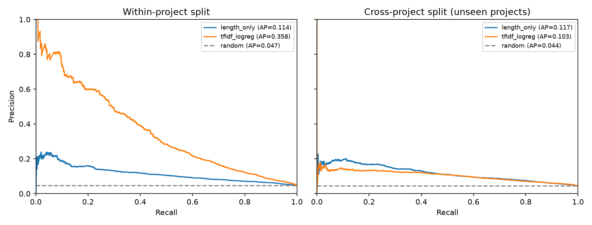
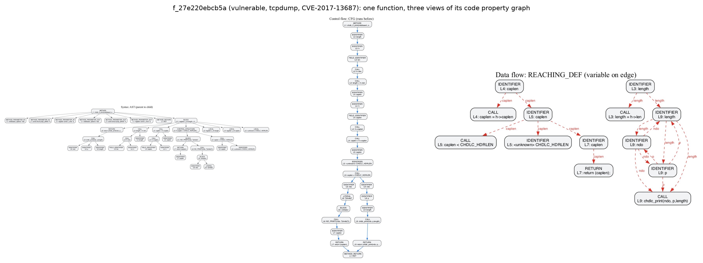

# GNN-Based Source Code Vulnerability Detection

> **Status:** Phase 1 (data and evaluation foundation) complete. Phase 2 (baselines and graph pipeline) in progress. No GNN results yet.

## Problem
Detect vulnerable C functions with a gated graph neural network over code property graphs (AST + control-flow + data-flow), localize the vulnerable lines, and evaluate on **projects the model has never seen**, against static-analysis and ML baselines.

## Dataset
BigVul (Fan et al., MSR 2020), original zip checksum-verified.

| | Functions | Vulnerable | Projects |
|---|---|---|---|
| Raw | 188,636 | 10,900 (5.8%) | 310 |
| After cleaning | 182,100 | 8,609 (4.7%) | 295 (aliases merged) |

Cleaning removed: 334 vulnerable rows whose fix only changes comments/whitespace; identical functions carrying both labels (1,274 vulnerable rows); redundant duplicates; functions over 8,000 characters (616 vulnerable). The dataset is 98.6% C.


## Evaluation protocol
- **Within-project split:** grouped by (project, function name), so the same function never appears on both sides.
- **Cross-project split:** whole projects held out for validation and test. Chrome, linux, Android and hosting-site pseudo-projects are train-only; the rest assigned by a seeded shuffle (seed 42), not hand-picked.
- **Leakage audit (MinHash, Jaccard >= 0.8 on token 5-grams):** 0.2% of cross-project and 2.6% of within-project val/test rows have a near-copy in train. Flagged cross-project rows are excluded from evaluation.
- **Metrics:** average precision, precision at fixed recall, F1. Accuracy is not reported (only 4.7% of functions are vulnerable).
- Hyperparameters and decision thresholds are chosen on the validation split only.



## Baseline results (preliminary)

| Split | Model | AP (95% CI) | ROC-AUC | Precision @ 30% recall |
|---|---|---|---|---|
| Within-project | Length only | 0.114 (0.103-0.128) | 0.713 | 0.132 |
| Within-project | TF-IDF + LogReg | 0.358 (0.326-0.392) | 0.844 | 0.484 |
| Cross-project | Length only | 0.117 (0.106-0.131) | 0.737 | 0.144 |
| Cross-project | TF-IDF + LogReg | 0.103 (0.095-0.115) | 0.730 | 0.126 |

Random baseline AP equals prevalence (about 0.047 within, 0.044 cross).

**Finding:** the lexical model is 7.6x better than random on code from seen projects, but only 2.3x on unseen projects, no better than function length alone. It appears to learn project-specific vocabulary rather than vulnerability patterns. Whether graph structure with identifier names abstracted away generalizes better is the hypothesis this project tests.



## Graph extraction pilot (Joern)

A first test of the graph stage: 60 BigVul functions (30 vulnerable, 30 safe; 250-1,200 characters, one per project per class) were parsed with Joern into code property graphs.

- **49 of 60 functions (82%)** produced a function graph; 11 did not (cause under investigation).
- **Graph size:** about 85 nodes and 650 edges per function on average (about 86 syntax edges, 69 control-flow edges, 165 data-flow edges, 46 control-dependence edges, plus other edge types).
- **Each graph maps back to its function:** every function is written as `f_<hash>.c`; the graph JSON stores that ID with the label, project, commit and CVE.
- **Note:** in BigVul a safe function carries the CVE of the commit it came from, so label 0 with a CVE ID is expected.

Example: `chdlc_if_print` from tcpdump (CVE-2017-13687, label: vulnerable), 38 nodes.
- Syntax: the function body block contains `length = h->len` and `caplen = h->caplen`.
- Control flow: `h->len` runs before `length = h->len`, which runs before the next statement.
- Data flow: the value read from `h->len` reaches the assignment `length = h->len`.



**Pilot limitations:** the sample is small and length-matched, so graph sizes say nothing about class differences. Functions come without headers, so macros and types stay unresolved (for example `<unknown> CHDLC_HDRLEN`).
## Roadmap
- [x] **Phase 1:** data, cleaning, leakage-safe splits, leakage audit
- [ ] **Phase 2:** Semgrep baseline, Joern code-property-graph extraction, PyTorch Geometric dataset with CodeBERT node features
- [ ] **Phase 3:** GGNN / R-GCN training, ablations (edge types, layers, with/without identifier text), Optuna tuning on project-disjoint validation, localization against fix diffs, final evaluation

## Reproduce
```bash
python -m venv .venv && source .venv/bin/activate
pip install -r requirements.txt
python scripts/download_bigvul.py
cd data/raw && unzip -q MSR_data_cleaned.zip && cd ../..
python src/vulngnn/data/prepare_bigvul.py
python src/vulngnn/data/make_splits.py
python src/vulngnn/data/near_dup_check.py
PYTHONPATH=src python src/vulngnn/train/baseline_tfidf.py
PYTHONPATH=src python src/vulngnn/eval/make_figures.py
```

## Limitations
- C code only; labels come from vulnerability-fix commits and are known to be noisy.
- Cleaning removes 21% of vulnerable examples (mostly label-conflict rows), so the dataset is easier than raw BigVul.
- Function-name grouping is coarse for macro-wrapped definitions (e.g. `PHP_FUNCTION`); this over-groups, which is safe for leakage.
- Near-duplicate check uses a 0.8 threshold; heavily modified copies may remain.
- Baseline regularization grid is narrow and confidence intervals are row-level bootstrap (optimistic).